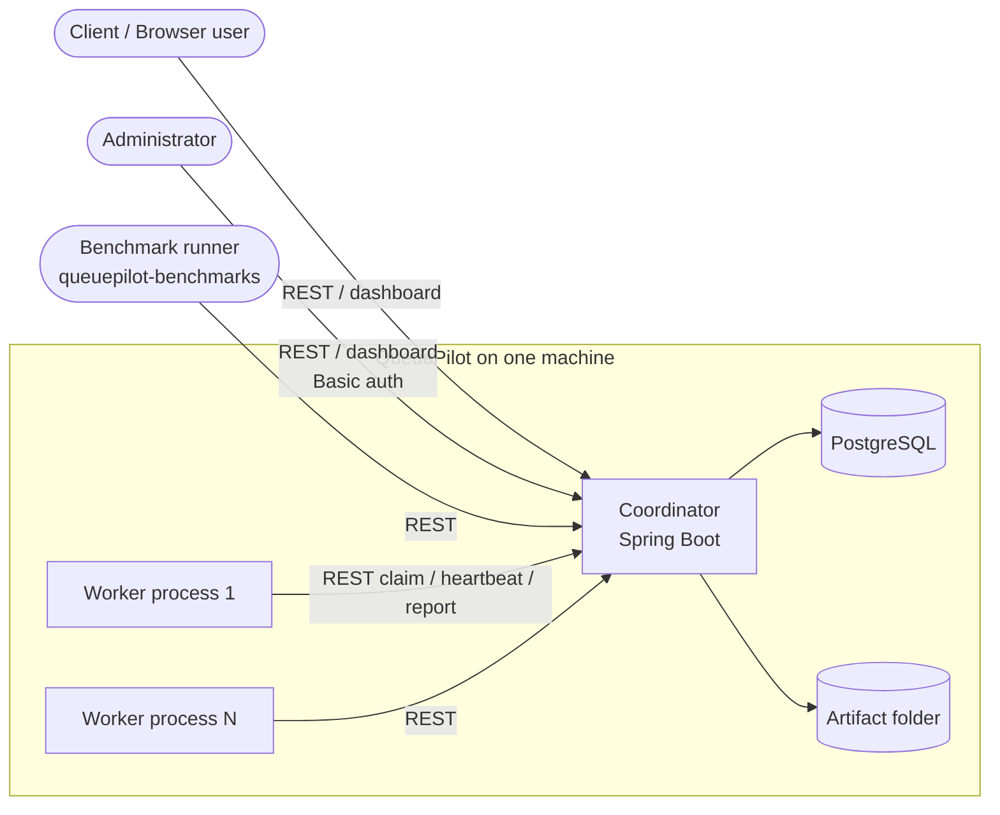
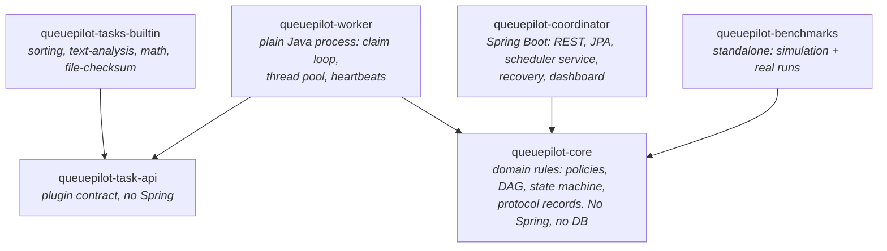
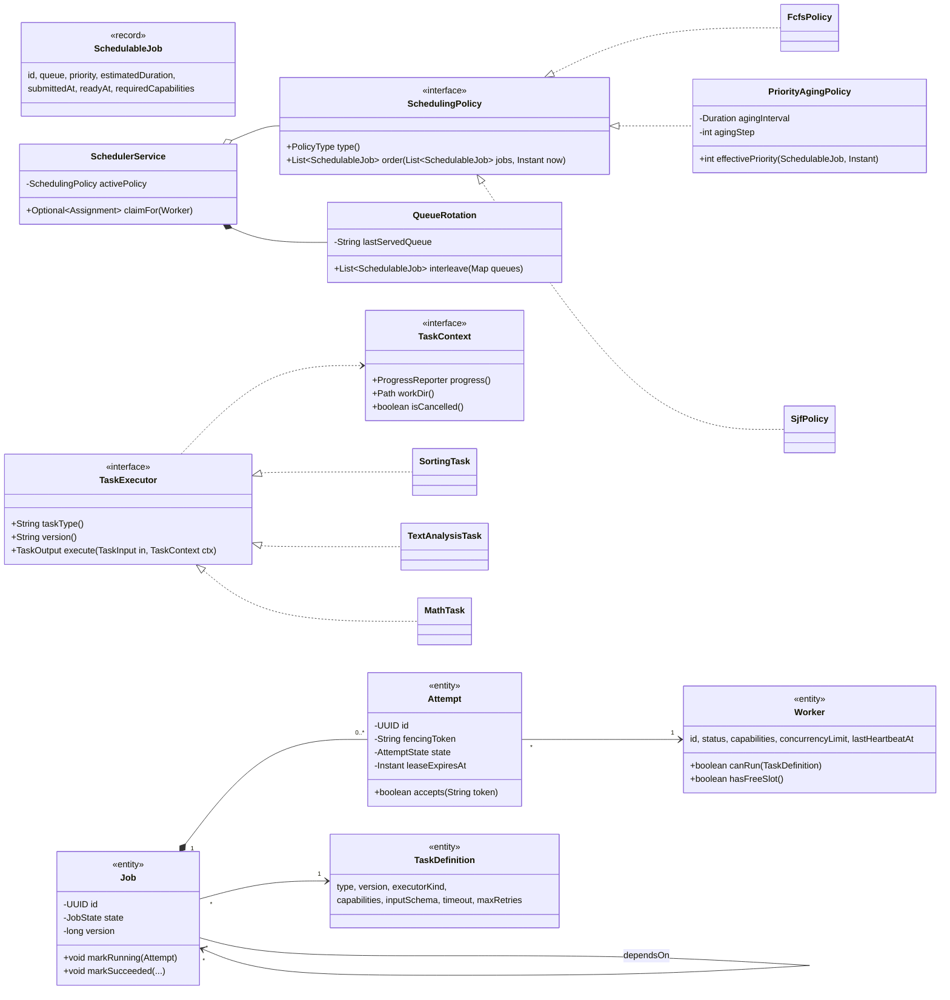
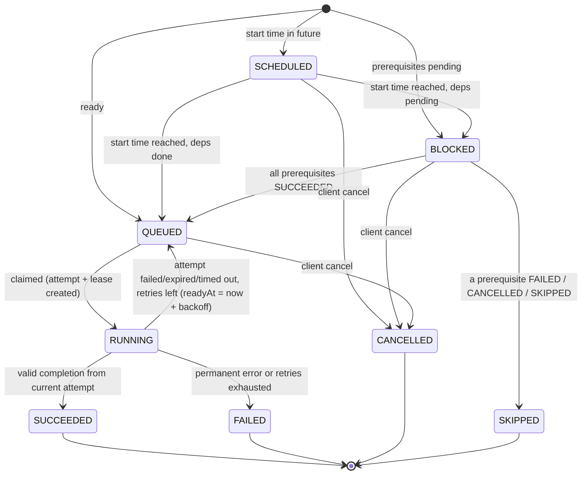
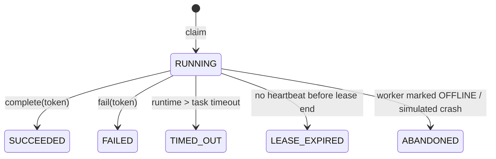
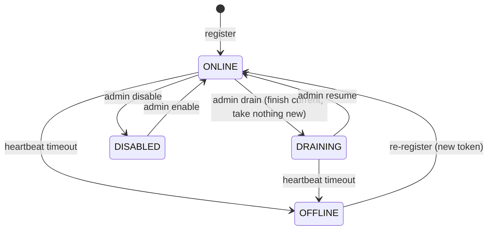
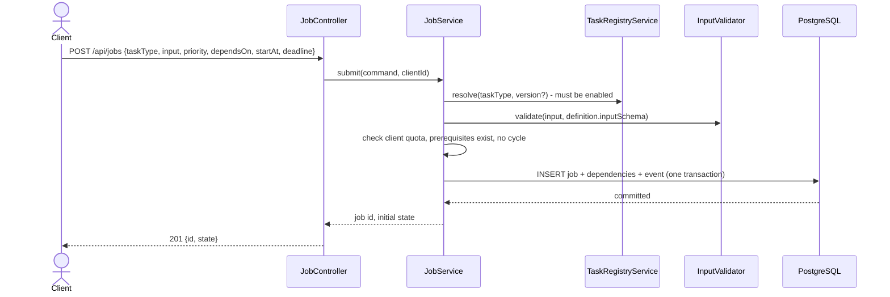
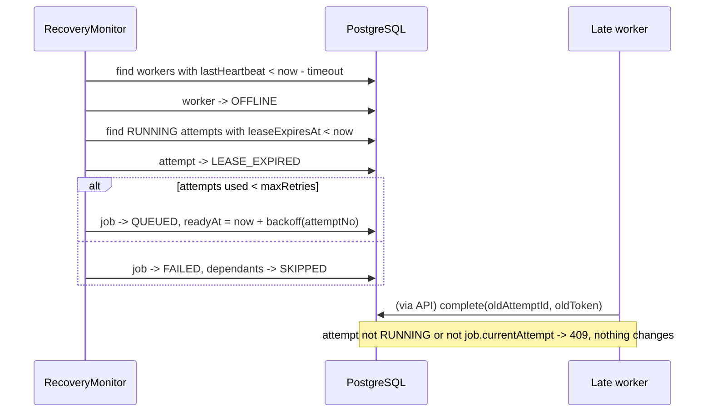
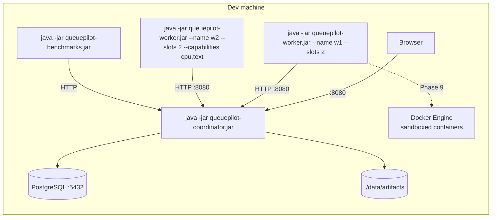

# QueuePilot v1.0 — System Architecture

Status: **Implemented** (v1.0). Decisions referenced as ADR-00x live in `docs/decisions/`. Container isolation (Phase 9) is implemented but not yet verified on Docker.

## 1. The one rule

> The scheduling engine never knows what a task does.

The scheduler sees a job as: *state, queue, priority, estimated duration, timestamps, dependencies, required capabilities*. Everything task-specific — how to validate the input beyond its schema, how to execute, what the output means — lives in a **plugin** that runs inside a **worker process**.

## 2. System context



Workers talk **only** to the coordinator's worker API. They never see the database or the artifact folder (ADR-003).

## 3. Maven modules (containers)



| Module | Why it is a separate module |
|---|---|
| `queuepilot-task-api` | Plugin authors depend on this tiny jar only. Keeps plugins independent of coordinator internals. |
| `queuepilot-core` | Scheduling policies and DAG rules are shared by the coordinator **and** the benchmark simulator; being Spring/DB-free makes them unit-testable in milliseconds. |
| `queuepilot-tasks-builtin` | Built-in tasks are ordinary plugins — proves the plugin path works. |
| `queuepilot-coordinator` | The only module with Spring Boot and the database. |
| `queuepilot-worker` | Independent process (ADR-002). Plain Java + `java.net.http.HttpClient` + Jackson; no Spring needed. |
| `queuepilot-benchmarks` | Must not be required to run the app (master prompt §6). |

The coordinator does **not** depend on `queuepilot-task-api` or any plugin: it cannot execute task code even by accident.

## 4. Coordinator components

```mermaid
flowchart TB
    subgraph web[web layer - controllers + DTOs]
        JC[JobController]
        WC[WorkflowController]
        TC[TaskDefinitionController]
        AC[ArtifactController]
        WAC[WorkerApiController<br/>/api/worker/**]
        ADC[AdminController]
        MC[MetricsController]
    end
    subgraph svc[service layer]
        JS[JobService]
        WFS[WorkflowService]
        TRS[TaskRegistryService]
        SVC[SchedulerService]
        WRS[WorkerRegistryService]
        ATS[AttemptService]
        RM[RecoveryMonitor<br/>@Scheduled]
        ST[ArtifactStorage]
        EV[EventLog]
    end
    subgraph corepkg[queuepilot-core]
        POL[SchedulingPolicy x3]
        FAIR[QueueRotation]
        DAG[DependencyGraph]
        SM[JobStateMachine]
        VAL[InputValidator]
    end
    REPO[(JPA repositories)]

    JC --> JS
    WC --> WFS --> JS
    TC --> TRS
    AC --> ST
    WAC --> WRS
    WAC --> SVC
    WAC --> ATS
    ADC --> SVC
    ADC --> WRS
    JS --> VAL
    JS --> DAG
    SVC --> POL
    SVC --> FAIR
    ATS --> SM
    RM --> ATS
    RM --> WRS
    JS & SVC & ATS & WRS & TRS --> REPO
    JS & ATS & RM --> EV
```

| Component | Responsibility | Fails how / mitigation |
|---|---|---|
| `JobService` | Validate + persist submissions, initial state, cancel, queries, per-client quota | DB error → 503, nothing acknowledged |
| `TaskRegistryService` | CRUD of task definitions; immutability once referenced | Duplicate `(type,version)` → 409 |
| `SchedulerService` | On worker claim: load candidates, apply readiness + capability filter, fairness, active policy; create attempt atomically | Two claims race for one job → optimistic lock (`@Version`); loser retries next candidate |
| `AttemptService` | Heartbeat, progress, complete, fail — all fenced by attempt ID + token | Stale token → 409, no change |
| `RecoveryMonitor` | Every *n* s: expire leases, time out attempts, mark silent workers `OFFLINE`, promote `SCHEDULED`→`QUEUED`, apply retry/backoff | Runs in one thread; each recovery action in its own transaction |
| `WorkerRegistryService` | Registration, tokens, capabilities, drain/disable, failure simulation | Re-registration after `OFFLINE` gets a fresh token |
| `ArtifactStorage` | `store / open / delete` files by ID; `LocalFileArtifactStorage` in v1.0 | Size limit, path never derived from user input |
| `EventLog` | Append-only system events for dashboard history | Written in the same transaction as the change it describes |

## 5. Package structure

```
queuepilot/
├── pom.xml                                   (parent, dependency versions)
├── queuepilot-task-api/  com.queuepilot.task
│     TaskExecutor, TaskContext, TaskInput, TaskOutput, TaskFailure, ProgressReporter
├── queuepilot-core/      com.queuepilot.core
│     job/        JobState, AttemptState, JobStateMachine, SchedulableJob
│     scheduling/ SchedulingPolicy, FcfsPolicy, PriorityAgingPolicy, SjfPolicy,
│                 PolicyType, QueueRotation, ReadinessRules
│     workflow/   DependencyGraph, CycleDetectedException
│     schema/     FieldSpec, FieldType, InputSchema, InputValidator, ValidationError
│     protocol/   RegisterWorkerRequest, ClaimResponse, HeartbeatRequest, ... (records)
├── queuepilot-tasks-builtin/  com.queuepilot.tasks.builtin
│     sorting/, text/, math/, checksum/   + META-INF/services + queuepilot-task.json manifests
├── queuepilot-coordinator/    com.queuepilot.coordinator
│     config/  security/  web/ (controllers, dto, error handling)
│     job/  workflow/  task/  scheduler/  worker/  attempt/  recovery/  artifact/  event/  metrics/
│     resources/ db/migration (Flyway), static/ (dashboard)
├── queuepilot-worker/         com.queuepilot.worker
│     WorkerMain, WorkerConfig, CoordinatorClient, ClaimLoop, AttemptRunner,
│     HeartbeatSender, PluginLoader, (Phase 9) ContainerTaskRunner
└── queuepilot-benchmarks/     com.queuepilot.benchmarks
      simulation/ (virtual clock, workload generator, metrics)
      execution/  (drives real coordinator + workers)   report/
```

Organisation is **by feature** inside the coordinator (all job code in `job/`), which keeps related controller-service-repository code together and is easier for a team of four to split.

## 6. Core classes



Where the OOP concepts show up (full mapping kept in `docs/oop-mapping.md` from Phase 2):

| Concept | Where |
|---|---|
| Encapsulation | `Job`, `Attempt`, `Worker` change state only through intention-revealing methods (`markRunning`, `accepts`) that enforce the state machine |
| Abstraction / polymorphism | `SchedulingPolicy`, `TaskExecutor`, `ArtifactStorage` (each has ≥ 2 real implementations or a real extension point) |
| Inheritance | `AbstractChunkedTask` base for built-in tasks that process data in chunks and report progress (only if it removes real duplication) |
| Composition | `SchedulerService` *has-a* policy and a queue rotation; `Job` *owns* its attempts |
| Collections | `PriorityQueue`/sorted lists in policies, `Map<String, Deque>` in queue rotation, adjacency `Map<UUID, Set<UUID>>` in DAG, `ConcurrentHashMap` in worker |
| Multithreading / sync | Worker thread pool, heartbeat thread, `@Scheduled` recovery, optimistic locking on claims |
| Exceptions | `ValidationException`, `StaleAttemptException`, `CycleDetectedException`, `TaskFailure` (retryable vs permanent) |
| File handling | Artifact storage, worker scratch directories, benchmark CSV reports |
| DB connectivity | Spring Data JPA repositories + Flyway SQL migrations |
| Patterns | Strategy (policies), Registry (plugins via `ServiceLoader`, task definitions) |

## 7. Job lifecycle



Retry delay is represented by `QUEUED` + `ready_at` in the future, not by an extra state. Cancelling a `RUNNING` job is not guaranteed in v1.0 (SRS U4); the API returns 409.

### Attempt lifecycle



### Worker lifecycle



## 8. Key flows

### 8.1 Submit a job (U1)



### 8.2 Claim, execute and complete (U3 + U4)

```mermaid
sequenceDiagram
    participant W as Worker process
    participant WAC as WorkerApiController
    participant S as SchedulerService
    participant A as AttemptService
    participant DB as PostgreSQL
    loop while free slot
        W->>WAC: POST /api/worker/claim (bearer token, freeSlots)
        WAC->>S: claimFor(worker)
        S->>DB: load QUEUED jobs where readyAt<=now
        S->>S: filter capabilities, QueueRotation, activePolicy.order()
        S->>DB: UPDATE job SET state=RUNNING, version=v+1 WHERE version=v; INSERT attempt(lease)
        S-->>W: 200 {jobId, attemptId, fencingToken, taskType, version, input, leaseSeconds, timeoutSeconds} or 204
    end
    par execute on pool thread
        W->>W: TaskExecutor.execute(input, ctx)
        W->>WAC: POST /attempts/{id}/progress {token, percent, message}
    and heartbeat thread
        W->>WAC: POST /api/worker/heartbeat {activeAttempts[{id, token}]}
        WAC->>A: renew leases (fenced)
    end
    W->>WAC: POST /attempts/{id}/complete {token, output}
    WAC->>A: complete
    A->>DB: attempt SUCCEEDED, job SUCCEEDED, unblock dependants, event
    A-->>W: 200  (or 409 if token stale)
```

### 8.3 Worker failure and recovery (U5)



## 9. Delivery and retry guarantees (honest version)

- A job may be **executed more than once** (a worker can finish its work after its lease expired). Built-in tasks are pure computations, so repeats are harmless.
- Only the **current** attempt can change job state. Late results are rejected with 409 and logged.
- Retries are bounded by the task definition's `maxRetries`, with exponential backoff (`base * 2^(n-1)`, capped).
- Failure detection time ≤ heartbeat timeout + recovery interval.
- If the coordinator restarts, running attempts are not trusted; they recover through normal lease expiry.
- There is **no exactly-once guarantee** and no multi-coordinator support.

## 10. Deployment (local)



Workers are separate **local** processes on the same machine; this document never claims multi-machine distribution.

## 11. Technical risks

| Risk | Impact | Mitigation |
|---|---|---|
| **External code execution (Phase 9)** | A container escape or misconfiguration compromises the machine | Never mount the Docker socket into containers; fixed image digests from registered packages; `--network none --read-only --user 65534 --cap-drop ALL --security-opt no-new-privileges --pids-limit --memory --cpus`; per-attempt temp dir only; worker (not coordinator) launches containers; isolation tests (network, FS write, fork bomb, memory). Docker is not installed on this machine yet. |
| Docker on Windows | Docker Desktop requires WSL2; behaviour differs from Linux | Treat Phase 9 as stretch; core demo must not depend on it |
| PostgreSQL not installed | Blocks running the app against the real DB | Phase 2 installs PostgreSQL natively; tests run against H2 in PostgreSQL mode with portable SQL; one integration profile runs against real PostgreSQL |
| Claim races | Double assignment | Optimistic locking on `job.version`; unit + concurrency tests with parallel claims |
| Clock-based logic | Flaky tests | Inject `java.time.Clock` everywhere; tests use a fixed/mutable clock |
| Plugin code in worker JVM | A buggy Java plugin can crash the worker | That is acceptable — it is exactly a worker failure, handled by recovery. Only trusted, admin-installed jars are loaded (ADR-005). |
| Scope (4–6 weeks, 12 phases) | Unfinished features | Core path first (Phases 2–8, 10); Phase 9 is stretch; each phase ends demoable |
| Honest durations | Real tasks finish in milliseconds and the demo looks dull | Size inputs (e.g. Monte Carlo samples, sieve limit, file size) so real work takes seconds; never sleep |
