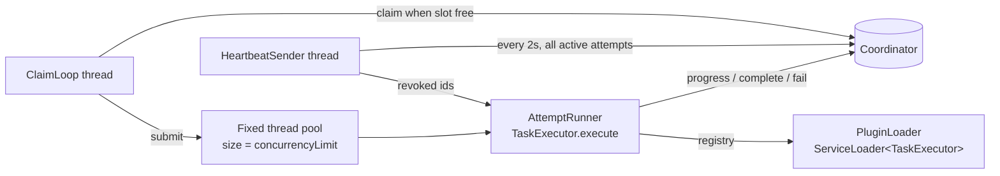

# Coordinator ↔ Worker Protocol

Transport: HTTP/1.1 + JSON, worker-initiated (pull). See ADR-003 for why pull-over-REST instead of push, gRPC or a message broker.

## Authentication

1. Worker starts with `--coordinator http://localhost:8080 --enroll-secret $QP_WORKER_SECRET`.
2. `POST /api/worker/register` with the enrollment secret → coordinator returns `workerId` and a random **worker token** (stored hashed).
3. Every later call sends `Authorization: Bearer <worker token>`.
4. Each attempt additionally has a **fencing token**; attempt calls must present both.

A worker token only allows the worker API for *that* worker: it cannot submit jobs, change policy, read other workers' attempts, or reach admin endpoints.

## Endpoints

| Call | Request | Response |
|---|---|---|
| `POST /api/worker/register` | `{name, concurrencyLimit, capabilities[], supportedTasks["sorting@1.0.0", …], enrollSecret}` | `201 {workerId, workerToken, heartbeatIntervalMs, leaseDurationMs}` |
| `POST /api/worker/claim` | `{freeSlots}` | `200 Assignment` or `204` (nothing eligible) |
| `POST /api/worker/heartbeat` | `{activeAttempts:[{attemptId, fencingToken}]}` | `200 {renewed:[ids], revoked:[ids]}` — revoked attempts must be abandoned locally |
| `POST /api/worker/attempts/{id}/progress` | `{fencingToken, percent, message}` | `200` / `409` stale |
| `POST /api/worker/attempts/{id}/complete` | `{fencingToken, output, outputArtifactIds[]}` | `200` / `409` stale |
| `POST /api/worker/attempts/{id}/fail` | `{fencingToken, errorCode, message, retryable}` | `200` / `409` stale |
| `GET  /api/worker/attempts/{id}/artifacts/{artifactId}` | header `X-Fencing-Token` | file bytes (only input artifacts of that job) |
| `POST /api/worker/attempts/{id}/artifacts` | multipart, `X-Fencing-Token` | `201 {artifactId}` (bounded size) |
| `POST /api/worker/deregister` | – | `200` (graceful shutdown) |

`Assignment`:
```json
{
  "attemptId": "…", "fencingToken": "…", "attemptNumber": 2,
  "jobId": "…", "taskType": "sorting", "taskVersion": "1.0.0",
  "input": { "numbers": [5, 3, 9], "algorithm": "MERGE" },
  "inputArtifactIds": [],
  "leaseDurationMs": 10000, "timeoutSeconds": 120
}
```

## Timing defaults (configurable)

| Setting | Default |
|---|---|
| Worker heartbeat interval | 2 s |
| Lease duration (renewed by each heartbeat) | 10 s |
| Worker offline after silence | 10 s |
| Recovery monitor interval | 1 s |
| Claim poll when idle | 1 s (no long-polling in v1.0) |
| Retry backoff | 2 s × 2^(n-1), max 60 s |

## Worker internals



- A semaphore of size `concurrencyLimit` gates claims, so a worker never holds more attempts than slots.
- Timeouts: `AttemptRunner` uses `Future.get(timeout)`; on timeout it cancels the task (interrupt), reports `fail(TIMEOUT)`. The coordinator also enforces the timeout independently, so a hung worker cannot keep a job forever.
- If the coordinator is unreachable, the worker retries with backoff; its leases will expire meanwhile, which is correct behaviour.

## Failure simulation (admin)

| Action | What actually happens |
|---|---|
| **Kill worker** | The dashboard calls `POST /api/admin/workers/{id}/simulate/kill`, which flags the worker; on its next heartbeat the worker receives `{"command":"EXIT"}` and calls `System.exit(137)` without reporting. Recovery then proceeds exactly as for a real crash. You can also just close the worker terminal. |
| **Freeze heartbeats** | Worker stops sending heartbeats but keeps computing → lease expires → retry elsewhere → the frozen worker's later `complete` is rejected (demonstrates fencing). |
| **Drain** | Worker finishes current attempts, gets `204` on claim. |
