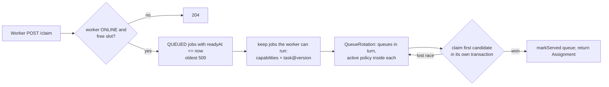

# Scheduling Design

**Purpose.** Decide which job a worker gets when it asks for work (U3, F4, F5, F7, F14).

**Why it exists.** Without it jobs would run in arbitrary order, workers could receive tasks they cannot run, and one client or queue could monopolise the system.

## Where the code lives

| Class | Module | Responsibility |
|---|---|---|
| `SchedulingPolicy` (+ `FcfsPolicy`, `PriorityAgingPolicy`, `SjfPolicy`) | core | Order a list of `SchedulableJob`s. Pure functions. |
| `QueueRotation` | core | Round-robin across queues; policy order inside each queue |
| `SchedulerService` | coordinator | Runs one dispatch decision per claim; previews the order for the dashboard |
| `SchedulerSettingsService` | coordinator | Active policy + aging + per-client limit; persisted, cached |
| `AttemptService.startAttempt` | coordinator | The atomic claim (attempt + lease + job state) |

## One dispatch decision

Readiness is fully encoded in the job row, so the query is simple:
- future start → `SCHEDULED` (released by the recovery monitor);
- unfinished prerequisites → `BLOCKED` (released by `DependencyService`);
- retry delay → `QUEUED` with `ready_at` in the future.

## Policies

| Policy | Order | Strength | Weakness |
|---|---|---|---|
| FCFS | `submittedAt`, then id | Fair, predictable | Convoy effect: short jobs wait behind long ones |
| Priority + Aging | `priority + floor(wait / interval) * step` desc, then `submittedAt` | Urgent work first, no permanent starvation | Needs tuning of interval/step |
| SJF | `estimatedMs`, then `submittedAt` | Minimum average wait | Long jobs can starve under load; relies on estimates |

Ties always fall back to submission time and finally id, so ordering is deterministic (required for reproducible benchmarks).

Aging is computed at decision time from `now - submittedAt`; nothing is written back. Policies are non-preemptive: a running job is never interrupted for a better candidate.

## Concurrency

Two workers may pick the same candidate. Each claim runs in its own transaction and updates the job with optimistic locking (`@Version`); the second commit fails with `OptimisticLockingFailureException`, which `SchedulerService` catches and moves on to the next candidate. `SchedulingTest.concurrentClaimsNeverAssignAJobTwice` runs 6 workers claiming 30 jobs in parallel and asserts every job got exactly one attempt.

## Failure scenarios

| Scenario | Behaviour |
|---|---|
| No worker has the capability | Job stays QUEUED; visible in the scheduler preview |
| Worker at its slot limit | 204, even if jobs are waiting |
| DB error during claim | Transaction rolls back; job stays QUEUED; worker retries |
| More than 500 claimable jobs | Only the oldest 500 are considered per decision (documented bound) |

## Testing

`SchedulingPolicyTest`, `QueueRotationTest` (core, milliseconds) and `SchedulingTest` (coordinator, through HTTP).
