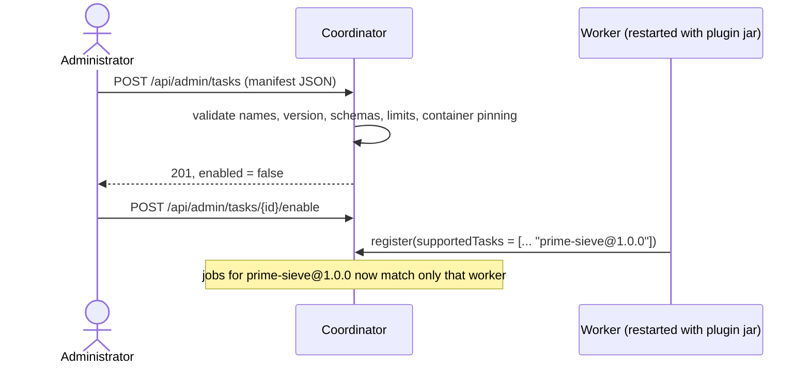

# Task Registry and Plugin Registration

The contract itself is in [task-plugin-contract.md](../architecture/task-plugin-contract.md). This note explains the moving parts and the registration flow.

## Registration flow

## Rules

- `(taskType, version)` is unique and immutable; changing a task means a new version.
- A job pins the version it was submitted with (latest enabled when not given).
- New registrations start **disabled**; built-in manifests are seeded **enabled** at startup by `SeedTaskLoader`.
- `CONTAINER` manifests must pin the image by digest (`name@sha256:...`) and automatically require the `docker` capability.
- Workers advertise implementations; they cannot create or change definitions.

## Why metadata and code are separate

| If they were together | Separated (our design) |
|---|---|
| The coordinator would load task code to learn the schema | The coordinator never loads plugin classes |
| Updating code would silently change validation | A new version is explicit and reviewable |
| A worker could declare any schema it likes | Only administrators define what jobs may contain |

## Classes

`TaskManifest` (request/seed format), `TaskDefinitionEntity` (stored row), `TaskRegistryService` (validation, resolve, enable), `TaskDefinitionController`, `SeedTaskLoader`; on the worker side `TaskExecutorRegistry`.
