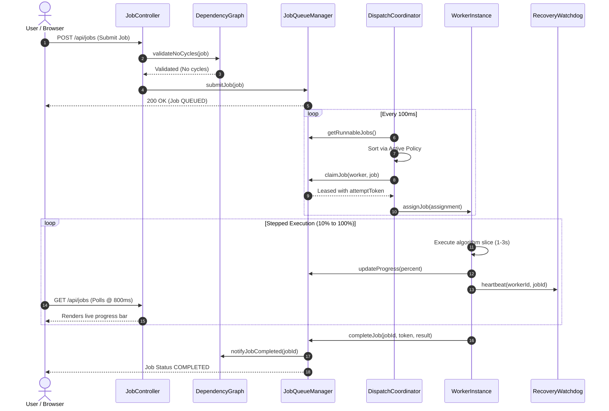
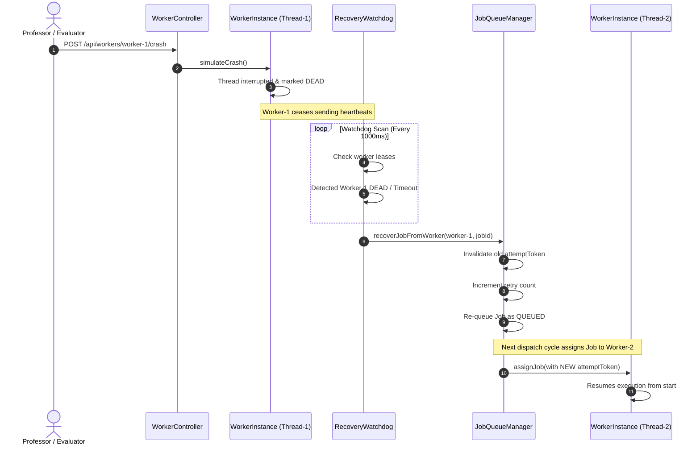

# QueuePilot: Comprehensive System Architecture & Engineering Blueprint

> **Course:** CS1207 Object Oriented Programming Lab  
> **Project Title:** QueuePilot – Miniature Task Execution, Job Scheduling & Worker Orchestration Platform  
> **Group:** II-19  
> **Author Team:** Om Kumar, Abhinav Singh Saini, Samyak Jain, Subhamjyoti Maharana  
> **Target Release:** Version 1.0 (Production-grade Educational System)  
> **Repository:** `com.queuepilot`  

---

## 📑 Detailed Table of Contents

1. [Executive Architecture Summary](#1-executive-architecture-summary)
2. [Technology Stack & Runtime Environment](#2-technology-stack--runtime-environment)
3. [System Architectural Decomposition (Subsystems)](#3-system-architectural-decomposition-subsystems)
4. [Exhaustive Package & Class Directory](#4-exhaustive-package--class-directory)
5. [In-Depth Job Scheduling Subsystem Architecture](#5-in-depth-job-scheduling-subsystem-architecture)
   - [5.1 Scheduling Lifecycle & State Transitions](#51-scheduling-lifecycle--state-transitions)
   - [5.2 First-Come, First-Served (FCFS)](#52-first-come-first-served-fcfs)
   - [5.3 Shortest Job First (SJF)](#53-shortest-job-first-sjf)
   - [5.4 Priority Scheduling with Dynamic Aging](#54-priority-scheduling-with-dynamic-aging)
   - [5.5 Multi-Level Feedback Queue (MLFQ)](#55-multi-level-feedback-queue-mlfq)
   - [5.6 Capability-Aware Worker Matching](#56-capability-aware-worker-matching)
6. [DAG Dependency Resolution & Cycle Detection Engine](#6-dag-dependency-resolution--cycle-detection-engine)
7. [Worker Pool & Concurrency Architecture](#7-worker-pool--concurrency-architecture)
8. [Fault Tolerance, Heartbeat Protocol & Lease Fencing](#8-fault-tolerance-heartbeat-protocol--lease-fencing)
9. [Persistence Architecture & Database Schema](#9-persistence-architecture--database-schema)
10. [REST API Interface & Contract Specification](#10-rest-api-interface--contract-specification)
11. [Frontend Dashboard Architecture & Telemetry](#11-frontend-dashboard-architecture--telemetry)
12. [End-to-End System Execution Workflows](#12-end-to-end-system-execution-workflows)

---

## 1. Executive Architecture Summary

QueuePilot is a resilient, event-driven task execution and job scheduling engine modeled after industrial workflow orchestrators (such as Apache Airflow, Kubernetes Kubelet, and Celery). It bridges theoretical operating system scheduling algorithms and modern multithreaded enterprise application architecture.

### Architectural Philosophy
1. **Decoupled State Machine:** Job states (`SUBMITTED`, `QUEUED`, `RUNNING`, `COMPLETED`, `FAILED`, `ABANDONED`) transition deterministically through validated state machine boundaries.
2. **Pluggable Strategy Engine:** Scheduling policies are isolated behind a common `SchedulingPolicy` interface, allowing hot-swapping between FCFS, SJF, Priority with Aging, and MLFQ without stopping worker threads.
3. **Hardware-Simulated Stepped Execution:** Jobs execute in stepped increments over **10 to 30 seconds**, emitting real-time progress percentages (10% to 100%) and continuous heartbeats to satisfy live professor demonstration requirements.
4. **Zero-Trust Lease Fencing:** Workers receive unique, time-bounded attempt tokens (`UUID`). Zombie or un-frozen threads cannot overwrite fresh database records or corrupt queue state.
5. **Deterministic DAG Prerequisite Gating:** Workloads form Directed Acyclic Graphs (DAGs). Dependent jobs remain blocked until all prerequisites finish successfully. Circular dependencies are trapped and rejected immediately via 3-color DFS graph traversal.

```
┌─────────────────────────────────────────────────────────────────────────────────────────┐
│                                   PRESENTATION LAYER                                    │
│       Vanilla JS Single Page Dashboard  •  Solid Color Theme  •  Polling @ 800ms        │
└────────────────────────────────────────────┬────────────────────────────────────────────┘
                                             │ HTTP REST / JSON
┌────────────────────────────────────────────▼────────────────────────────────────────────┐
│                                   REST API CONTROLLERS                                  │
│   JobController  •  WorkerController  •  SchedulerController  •  BenchmarkController    │
└────────────────────────────────────────────┬────────────────────────────────────────────┘
                                             │ In-Memory Invocations
┌────────────────────────────────────────────▼────────────────────────────────────────────┐
│                             DISPATCH & ORCHESTRATION ENGINE                             │
│       DispatchCoordinator (100ms Loop)  ◄────►  JobQueueManager (ReentrantLock)        │
│                         │                                        │                      │
│        Sorts via        │                                        │ Validates via        │
│                         ▼                                        ▼                      │
│        ┌─────────────────────────────────┐      ┌─────────────────────────────────┐     │
│        │    SCHEDULING STRATEGY POOL     │      │     DEPENDENCY GRAPH (DAG)      │     │
│        │  FCFS • SJF • Aging • MLFQ      │      │  3-Color DFS Cycle Detection    │     │
│        └─────────────────────────────────┘      └─────────────────────────────────┘     │
└────────────────────────┬─────────────────────────────────────────┬──────────────────────┘
                         │ Assigns Leased Work                     │ Event Listener
┌────────────────────────▼─────────────────────────────────────────▼──────────────────────┐
│                                WORKER POOL SUBSYSTEM                                    │
│   WorkerPool  •  WorkerInstance (Thread-1)  •  WorkerInstance (Thread-2)  •  ...        │
│                                │                                                        │
│                                ▼ Dispatches via Polymorphic Registry                    │
│   ┌─────────────────────────────────────────────────────────────────────────────────┐   │
│   │                              JOB EXECUTOR REGISTRY                              │   │
│   │    SortingJobExecutor  •  TextAnalysisJobExecutor  •  MathComputeJobExecutor    │   │
│   └─────────────────────────────────────────────────────────────────────────────────┘   │
└────────────────────────┬─────────────────────────────────────────┬──────────────────────┘
                         │ Heartbeats & Leases                     │ Persists Audit Logs
┌────────────────────────▼───────────────────┐  ┌──────────────────▼──────────────────────┐
│          FAULT TOLERANCE ENGINE            │  │            PERSISTENCE ENGINE           │
│   RecoveryWatchdog (1s Polling Loop)       │  │   Spring Data JPA + Hibernate           │
│   Lease Expiry  •  Zombie Fence Rejection  │  │   H2 / PostgreSQL Database              │
└────────────────────────────────────────────┘  └─────────────────────────────────────────┘
```

---

## 2. Technology Stack & Runtime Environment

| Category | Technology | Version | Purpose in QueuePilot |
| :--- | :--- | :--- | :--- |
| **Language & JDK** | Java (OpenJDK) | 27 / 17+ Baseline | Platform base; records, switch expressions, synchronization primitives, concurrency. |
| **Backend Framework** | Spring Boot | 3.3.4 | Core container, Dependency Injection, REST web controllers, scheduled tasks. |
| **ORM & Persistence** | Spring Data JPA / Hibernate | 6.5.3.Final | Entity mapping, transactional persistence, repository queries for audit logging. |
| **Database Engine** | H2 Database Engine | 2.2.224 | Embedded, zero-configuration relational persistence; easily swappable with PostgreSQL. |
| **Build Automation** | Apache Maven | 3.9.6 | Dependency management, build lifecycle, surefire test runner, fat JAR packaging. |
| **Testing Framework** | JUnit 5 (Jupiter) + Mockito | 5.10.3 | Unit, integration, and concurrency verification suite (26 automated test cases). |
| **JSON Serialization** | Jackson Databind | 2.17.2 | DTO marshaling/unmarshaling, REST response serialization. |
| **Frontend UI** | HTML5 / CSS3 / Vanilla JS | Modern ES6+ | Real-time interactive control panel, telemetry charts, solid-color theme. |
| **Client Telemetry** | HTTP Fetch Polling | 800ms cadence | Ultra-responsive, zero-dependency streaming state synchronization. |

---

## 3. System Architectural Decomposition (Subsystems)

The architecture is cleanly separated into eight cooperating subsystems:

### 3.1 Presentation & Telemetry Subsystem
- Located in `src/main/resources/static/` ([`index.html`](src/main/resources/static/index.html), [`app.js`](src/main/resources/static/app.js), [`style.css`](src/main/resources/static/style.css)).
- Implements an asynchronous polling engine updating DOM nodes every 800ms without full-page reloads.
- Contains the 7-step scenario demonstration suite (Seed Workload, Policy Switching, Worker Crash, DAG Execution, Benchmark Compare).
- **Design Philosophy:** Uses a solid color theme without multi-color gradients for clean contrast and professional presentation.

### 3.2 API & Adapter Subsystem
- Located in `com.queuepilot.api` ([`JobController`](src/main/java/com/queuepilot/api/JobController.java), [`WorkerController`](src/main/java/com/queuepilot/api/WorkerController.java), [`SchedulerController`](src/main/java/com/queuepilot/api/SchedulerController.java), [`EventController`](src/main/java/com/queuepilot/api/EventController.java), [`BenchmarkController`](src/main/java/com/queuepilot/api/BenchmarkController.java)).
- Translates external HTTP JSON payloads into typed internal domain commands and returns structured responses.
- Decouples client contracts from internal concurrent entity representations via Data Transfer Objects (`com.queuepilot.dto`).

### 3.3 Dispatch & Orchestration Engine
- Located in `com.queuepilot.dispatch` ([`DispatchCoordinator`](src/main/java/com/queuepilot/dispatch/DispatchCoordinator.java), [`JobQueueManager`](src/main/java/com/queuepilot/dispatch/JobQueueManager.java)).
- Acts as the central nervous system. Runs a continuous background daemon thread evaluating runnable jobs against idle workers.
- Protects queue operations with a re-entrant mutual exclusion lock ([`ReentrantLock`](file:///home/ricing/Documents/code/Projects/QueuePilot_v2/src/main/java/com/queuepilot/dispatch/JobQueueManager.java)).

### 3.4 Scheduling & Policy Subsystem
- Located in `com.queuepilot.scheduler` ([`SchedulingPolicy`](src/main/java/com/queuepilot/scheduler/SchedulingPolicy.java), [`FcFSSchedulingPolicy`](src/main/java/com/queuepilot/scheduler/FcFSSchedulingPolicy.java), [`SjfSchedulingPolicy`](src/main/java/com/queuepilot/scheduler/SjfSchedulingPolicy.java), [`PriorityAgingSchedulingPolicy`](src/main/java/com/queuepilot/scheduler/PriorityAgingSchedulingPolicy.java), [`MlfqSchedulingPolicy`](src/main/java/com/queuepilot/scheduler/MlfqSchedulingPolicy.java), [`SchedulerPolicyFactory`](src/main/java/com/queuepilot/scheduler/SchedulerPolicyFactory.java)).
- Pure algorithmic layer implementing the Strategy Pattern. Sorts candidates based on arrival time, estimated duration, dynamic effective priority, or multi-level feedback queues.

### 3.5 DAG Dependency Subsystem
- Located in `com.queuepilot.dag` ([`DependencyGraph`](src/main/java/com/queuepilot/dag/DependencyGraph.java), [`CycleDetectedException`](src/main/java/com/queuepilot/dag/CycleDetectedException.java)).
- Maintains an in-memory directed dependency graph.
- Executes 3-color Depth First Search (DFS) upon job submission to guarantee no circular dependencies enter the system.

### 3.6 Worker Pool & Execution Subsystem
- Located in `com.queuepilot.worker` ([`WorkerPool`](src/main/java/com/queuepilot/worker/WorkerPool.java), [`WorkerInstance`](src/main/java/com/queuepilot/worker/WorkerInstance.java), [`WorkerEventListener`](src/main/java/com/queuepilot/worker/WorkerEventListener.java)) and `com.queuepilot.executor` ([`JobExecutor`](src/main/java/com/queuepilot/executor/JobExecutor.java), [`ExecutorRegistry`](src/main/java/com/queuepilot/executor/ExecutorRegistry.java)).
- Manages 4 dedicated OS execution threads.
- Dynamically resolves polymorphic executors based on `job.getType()`.
- Drives stepped execution emitting incremental progress reports and heartbeats.

### 3.7 Fault Tolerance & Recovery Watchdog
- Located in `com.queuepilot.recovery` ([`RecoveryWatchdog`](src/main/java/com/queuepilot/recovery/RecoveryWatchdog.java)).
- Runs a scheduled background inspection task every 1 second.
- Detects frozen or crashed workers, reclaims abandoned leases, triggers retries with exponential backoff, and fences out zombie attempts.

### 3.8 Persistence & Audit Subsystem
- Located in `com.queuepilot.persistence` ([`AuditService`](src/main/java/com/queuepilot/persistence/AuditService.java), JPA entities and repositories).
- Asynchronously persists immutable historical records of every job attempt, worker status transition, and system failure event.

---

## 4. Exhaustive Package & Class Directory

```
src/main/java/com/queuepilot/
├── QueuePilotApplication.java                  [Spring Boot Main Entry Point]
│
├── api/                                        [REST API Interface Adapters]
│   ├── BenchmarkController.java                [Runs comparative multi-algorithm benchmark]
│   ├── EventController.java                    [Streams recent audit and system events]
│   ├── JobController.java                      [Submits, lists, cancels, and queries jobs]
│   ├── SchedulerController.java                [Inspects and switches active scheduling strategy]
│   └── WorkerController.java                   [Queries workers, simulates crash/revive]
│
├── benchmark/                                  [Simulation & Benchmark Engine]
│   ├── BenchmarkService.java                   [Discrete-event multi-policy simulation]
│   └── DemoWorkloadService.java                [Generates 10-job 10-30s stepped demo workload]
│
├── dag/                                        [Graph & Cycle Detection Engine]
│   ├── CycleDetectedException.java             [Unchecked exception thrown on graph circularity]
│   └── DependencyGraph.java                    [Adjacency list & 3-Color DFS cycle validator]
│
├── dispatch/                                   [Orchestration & Queue Subsystem]
│   ├── DispatchCoordinator.java                [Background daemon matching jobs to workers]
│   └── JobQueueManager.java                    [Thread-safe ReentrantLock queue coordinator]
│
├── dto/                                        [Data Transfer Objects]
│   ├── BenchmarkResultDto.java                 [JSON response for benchmark metrics]
│   ├── JobResponse.java                        [JSON representation of job state]
│   ├── SubmitJobRequest.java                   [JSON request payload for job submission]
│   └── WorkerResponse.java                     [JSON representation of worker status]
│
├── executor/                                   [Polymorphic Execution Engine]
│   ├── ExecutorRegistry.java                   [Thread-safe registry mapping JobType to Executor]
│   ├── HeartbeatCallback.java                  [@FunctionalInterface for worker heartbeat pulses]
│   ├── JobExecutor.java                        [Strategy contract for stepped task execution]
│   ├── MathComputeJobExecutor.java             [Executes Monte Carlo pi / iterative math]
│   ├── ProgressCallback.java                   [@FunctionalInterface for progress reporting]
│   ├── SortingJobExecutor.java                 [Executes stepped dataset sorting]
│   └── TextAnalysisJobExecutor.java            [Executes text corpus tokenization & indexing]
│
├── model/                                      [Domain Entities & Value Objects]
│   ├── Job.java                                [Abstract base entity modeling universal state]
│   ├── JobPriority.java                        [Enum: LOW(1), NORMAL(2), HIGH(3), CRITICAL(4)]
│   ├── JobResult.java                          [Immutable result object with Builder]
│   ├── JobState.java                           [Enum: SUBMITTED, QUEUED, RUNNING, COMPLETED, ...]
│   ├── JobType.java                            [Enum: SORTING, TEXT_ANALYSIS, MATH_COMPUTE]
│   ├── MathComputeJob.java                     [Specialized job holding mathematical parameters]
│   ├── SortingJob.java                         [Specialized job holding numerical dataset]
│   ├── TextAnalysisJob.java                    [Specialized job holding text corpus]
│   ├── Worker.java                             [Domain entity tracking worker status & lease]
│   └── WorkerStatus.java                       [Enum: IDLE, BUSY, UNRESPONSIVE, DEAD]
│
├── persistence/                                [JPA Persistence & Audit Logging]
│   ├── AuditService.java                       [Transactional bridge syncing memory to database]
│   ├── JobAttemptEntity.java                   [Entity recording individual execution attempts]
│   ├── JobAttemptRepository.java               [Spring Data JPA repository for attempts]
│   ├── JobEntity.java                          [Entity mirroring persistent job state]
│   ├── JobRepository.java                      [Spring Data JPA repository for jobs]
│   ├── SystemEventEntity.java                  [Entity logging crash, recovery, and policy events]
│   ├── SystemEventRepository.java              [Spring Data JPA repository for events]
│   ├── WorkerEntity.java                       [Entity recording worker registration & health]
│   └── WorkerRepository.java                   [Spring Data JPA repository for workers]
│
├── recovery/                                   [Fault Tolerance & Lease Watchdog]
│   └── RecoveryWatchdog.java                   [Scheduled watchdog scanning leases & crashes]
│
├── scheduler/                                  [Scheduling Policy Strategy Implementations]
│   ├── FcFSSchedulingPolicy.java               [First-Come, First-Served policy]
│   ├── MlfqSchedulingPolicy.java               [Multi-Level Feedback Queue with boost]
│   ├── PolicyType.java                         [Enum: FCFS, SJF, PRIORITY_AGING, MLFQ]
│   ├── PriorityAgingSchedulingPolicy.java      [Dynamic priority aging policy]
│   ├── SchedulerPolicyFactory.java             [Factory creating policy instances]
│   ├── SchedulingPolicy.java                   [Common Strategy interface for scheduling]
│   └── SjfSchedulingPolicy.java                [Shortest Job First policy]
│
└── worker/                                     [Worker Pool & Concurrency Engine]
    ├── JobAssignment.java                      [Immutable tuple binding Job, Worker, and Token]
    ├── WorkerEventListener.java                [Observer contract for worker lifecycle events]
    ├── WorkerInstance.java                     [Runnable thread wrapper executing tasks]
    └── WorkerPool.java                         [Manager orchestrating the 4 concurrent threads]
```

---

## 5. In-Depth Job Scheduling Subsystem Architecture

The scheduling subsystem decides **which job runs next, on which worker, and when**. It separates policy from mechanism: `JobQueueManager` and `DispatchCoordinator` manage the mechanics of queues and threads, while `SchedulingPolicy` defines the ordering strategy.

```
                  ┌───────────────────────────────────────────────┐
                  │                 SUBMITTED                     │
                  └───────────────────────┬───────────────────────┘
                                          │ Passes DAG Cycle Check
                                          ▼
                  ┌───────────────────────────────────────────────┐
                  │                  QUEUED                       │◄────────┐
                  └───────────────────────┬───────────────────────┘         │
                                          │ Filtered by Dependencies        │
                                          ▼                                 │
                  ┌───────────────────────────────────────────────┐         │
                  │             READY / RUNNABLE                  │         │ Re-queued on
                  └───────────────────────┬───────────────────────┘         │ Crash / Timeout
                                          │ Sorted by Active Policy         │ (Retry < Max)
                                          │ Matched to Idle Worker          │
                                          ▼                                 │
                  ┌───────────────────────────────────────────────┐         │
                  │                  RUNNING                      │─────────┘
                  └───────────┬───────────────────────┬───────────┘
                              │                       │
           Execution Complete │                       │ Unrecoverable Error
           Without Faults     │                       │ or Max Retries Exceeded
                              ▼                       ▼
                  ┌───────────────────────┐ ┌─────────────────────┐
                  │       COMPLETED       │ │       FAILED        │
                  └───────────────────────┘ └─────────────────────┘
```

### 5.1 Scheduling Lifecycle & State Transitions

1. **Submission (`SUBMITTED`):** A client posts a JSON payload to `/api/jobs`. The system validates schema invariants, wraps the payload in a concrete subclass (`SortingJob`, `TextAnalysisJob`, `MathComputeJob`), and inserts it into `DependencyGraph`.
2. **Cycle Validation:** The graph runs a 3-color DFS traversal. If a cycle is detected, `CycleDetectedException` is thrown, returning HTTP 400.
3. **Queue Ingestion (`QUEUED`):** The job enters `JobQueueManager`. If it has unfinished prerequisites, it remains in `QUEUED` state but is marked non-runnable.
4. **Dispatch Selection (`RUNNABLE`):** `DispatchCoordinator` periodically retrieves all runnable jobs (jobs whose dependencies are 100% `COMPLETED`).
5. **Strategy Ordering:** The active `SchedulingPolicy` sorts the runnable list according to its algorithmic rules.
6. **Worker Capability Matching:** The coordinator finds the first idle worker whose capability tags satisfy the job's requirements.
7. **Execution Assignment (`RUNNING`):** An atomic lease is created with a new `attemptToken` (UUID). The job transitions to `RUNNING`, and the worker thread begins stepped execution.
8. **Terminal Resolution:**
   - On success: transitions to `COMPLETED`, unblocking downstream DAG dependencies.
   - On failure/crash: `RecoveryWatchdog` increments retry count. If $\text{retry} < \text{maxRetries}$, it transitions back to `QUEUED`; otherwise, it transitions to `FAILED`.

---

### 5.2 First-Come, First-Served (FCFS)
- **Class:** [`FcFSSchedulingPolicy`](src/main/java/com/queuepilot/scheduler/FcFSSchedulingPolicy.java)
- **Algorithm:** Orders runnable jobs strictly by their creation timestamp (`job.getCreatedAt()`).
- **Mathematical Invariant:**
  $$\forall i < j \implies \text{createdAt}(Job_i) \le \text{createdAt}(Job_j)$$
- **Algorithmic Complexity:** $O(N \log N)$ sort using a stable comparison.
- **Strengths:** Strictly fair; zero starvation; simple to reason about.
- **Weaknesses:** Susceptible to the **Convoy Effect**, where a 30-second compute task blocks numerous 10-second interactive tasks behind it in the queue.

---

### 5.3 Shortest Job First (SJF)
- **Class:** [`SjfSchedulingPolicy`](src/main/java/com/queuepilot/scheduler/SjfSchedulingPolicy.java)
- **Algorithm:** Orders runnable jobs strictly by their estimated execution duration (`job.getEstimatedDurationSeconds()`). If durations are identical, breaks ties with arrival timestamp (FCFS).
- **Mathematical Invariant:**
  $$\forall i < j \implies \text{duration}(Job_i) \le \text{duration}(Job_j)$$
- **Algorithmic Complexity:** $O(N \log N)$ sort.
- **Strengths:** Mathematically proven to minimize average waiting time and turnaround time across all jobs.
- **Weaknesses:** Vulnerable to **Starvation**. If a stream of short 10-second jobs continuously arrives, a 30-second job will wait indefinitely.

---

### 5.4 Priority Scheduling with Dynamic Aging
- **Class:** [`PriorityAgingSchedulingPolicy`](src/main/java/com/queuepilot/scheduler/PriorityAgingSchedulingPolicy.java)
- **Algorithm:** Solves the starvation dilemma of static priority scheduling by implementing **Dynamic Priority Aging**. Every job has a base priority (`LOW=1`, `NORMAL=2`, `HIGH=3`, `CRITICAL=4`). As a job waits in the queue, its effective priority increases at a configured time interval.
- **Mathematical Formulation:**
  $$\text{effectivePriority}(Job) = \text{basePriority} + \left( \left\lfloor \frac{t_{\text{current}} - t_{\text{arrival}}}{T_{\text{interval}}} \right\rfloor \times \Delta P \right)$$
  - Default parameters: $T_{\text{interval}} = 10\text{ seconds}$, $\Delta P = 1\text{ level}$.
- **Sorting Rule:** Jobs are sorted by $\text{effectivePriority}$ in descending order; ties are broken by arrival timestamp (FIFO).
- **Starvation Elimination Guarantee:**
  $$\lim_{t \to \infty} \text{effectivePriority}(Job) = \infty$$
  Every low-priority job will eventually surpass higher-priority arrivals and execute.

---

### 5.5 Multi-Level Feedback Queue (MLFQ)
- **Class:** [`MlfqSchedulingPolicy`](src/main/java/com/queuepilot/scheduler/MlfqSchedulingPolicy.java)
- **Algorithm:** The most advanced general-purpose scheduling policy in modern operating systems. It separates jobs into multiple priority tiers without requiring a priori knowledge of job duration.

```
   New Jobs Ingested
          │
          ▼
   ┌───────────────────────────────────────────────────────────────┐
   │  TIER 0 (High Priority)    •  Estimated Duration <= 5 seconds │
   └──────────────────────────────┬────────────────────────────────┘
                                  │ Exceeds 5s Threshold
                                  ▼
   ┌───────────────────────────────────────────────────────────────┐
   │  TIER 1 (Medium Priority)  •  Estimated Duration 5 - 15 sec   │
   └──────────────────────────────┬────────────────────────────────┘
                                  │ Exceeds 15s Threshold
                                  ▼
   ┌───────────────────────────────────────────────────────────────┐
   │  TIER 2 (Low / Batch Queue)•  Estimated Duration > 15 sec     │
   └───────────────────────────────────────────────────────────────┘
                                  ▲
                                  │ Periodic Priority Boost (Every 20s)
                                  └─ All waiting jobs reset to Tier 0!
```

#### MLFQ Operational Rules:
1. **Rule 1 (Tier Placement):** If $\text{Job}_A$ is in a higher tier than $\text{Job}_B$, $\text{Job}_A$ executes first:
   $$\text{tier}(\text{Job}_A) < \text{tier}(\text{Job}_B) \implies \text{priority}(\text{Job}_A) > \text{priority}(\text{Job}_B)$$
2. **Rule 2 (Round-Robin within Tier):** If jobs reside in the same tier, they are scheduled via FCFS.
3. **Rule 3 (Dynamic Demotion):** When a job requires significant execution time, it demotes down through tiers (Tier 0 $\to$ Tier 1 $\to$ Tier 2).
4. **Rule 4 (Anti-Starvation Periodic Priority Boost):** To prevent batch tasks in Tier 2 from starving when short tasks arrive continuously, an anti-starvation boost fires every $S = 20\text{ seconds}$, promoting all waiting jobs back to Tier 0.

---

### 5.6 Capability-Aware Worker Matching
Workers in QueuePilot are heterogeneous and specialize in distinct compute profiles:
- **`worker-1`:** Capabilities: `CPU_INTENSIVE`, `GENERAL` (Core count: 4)
- **`worker-2`:** Capabilities: `MEMORY_INTENSIVE`, `GENERAL` (Core count: 4)
- **`worker-3`:** Capabilities: `IO_BOUND`, `GENERAL` (Core count: 2)
- **`worker-4`:** Capabilities: `CPU_INTENSIVE`, `MEMORY_INTENSIVE`, `GENERAL` (Core count: 8)

When matching, `JobQueueManager` checks:
```java
public boolean canWorkerExecute(Worker worker, Job job) {
    if (job.getRequiredCapability() == null || job.getRequiredCapability().isBlank()) {
        return true;
    }
    return worker.getCapabilities().contains(job.getRequiredCapability()) ||
           worker.getCapabilities().contains("GENERAL");
}
```
This guarantees memory-heavy or CPU-bound jobs are only bound to hardware capable of servicing them.

---

## 6. DAG Dependency Resolution & Cycle Detection Engine

Complex enterprise data pipelines are rarely isolated jobs; they form **Directed Acyclic Graphs (DAGs)**. For example:
$$\text{Data Ingestion} \longrightarrow \text{Feature Extraction} \longrightarrow \text{Model Training}$$

```
                ┌────────────────────────┐
                │ Job A: Data Ingestion  │
                └───────────┬────────────┘
                            │
              ┌─────────────┴─────────────┐
              ▼                           ▼
  ┌───────────────────────┐   ┌───────────────────────┐
  │ Job B: Feature Extr-1 │   │ Job C: Feature Extr-2 │
  └───────────┬───────────┘   └───────────┬───────────┘
              │                           │
              └─────────────┬─────────────┘
                            ▼
                ┌───────────────────────┐
                │ Job D: Model Training │
                └───────────────────────┘
```

### 6.1 Directed Graph Representation
In [`DependencyGraph.java`](src/main/java/com/queuepilot/dag/DependencyGraph.java), dependencies are stored as an adjacency list:
- `adjacencyList`: Maps a job ID to the set of job IDs that **depend on it** (dependents).
- `dependencies`: Maps a job ID to the set of job IDs it **requires** (prerequisites).

### 6.2 3-Color DFS Cycle Detection Algorithm
To prevent infinite deadlock loops from being scheduled, the system inspects every addition using the standard 3-Color graph coloring algorithm:

```
[WHITE] : Unvisited vertex (not yet encountered)
[GRAY]  : Visiting vertex (currently active on the DFS recursion stack)
[BLACK] : Visited vertex (completely processed along all outgoing paths)
```

#### Traversal Algorithm:
1. Initialize all vertices in the graph as `WHITE`.
2. For each vertex $u \in V$:
   - If $\text{color}(u) == \text{WHITE}$, invoke `dfs(u)`.
3. In `dfs(u)`:
   - Set $\text{color}(u) \leftarrow \text{GRAY}$.
   - For each adjacent vertex $v$ where edge $(u \to v)$ exists:
     - If $\text{color}(v) == \text{GRAY}$: **A back-edge is detected! Circular dependency confirmed.**
     - Throw [`CycleDetectedException("Cycle detected involving job " + v)`](src/main/java/com/queuepilot/dag/CycleDetectedException.java).
     - If $\text{color}(v) == \text{WHITE}$: recursively call `dfs(v)`.
   - Set $\text{color}(u) \leftarrow \text{BLACK}$.

**Time Complexity:** $\mathcal{O}(V + E)$, where $V$ is the number of jobs and $E$ is the number of dependency edges.

---

## 7. Worker Pool & Concurrency Architecture

QueuePilot utilizes a dedicated platform thread model to ensure isolated, resilient worker execution.

```
┌─────────────────────────────────────────────────────────────────────────────┐
│                       DispatchCoordinator Daemon Thread                     │
│               Runs while(running) loop with 100ms sleep intervals           │
└───────────────┬─────────────────────────────────────────────┬───────────────┘
                │ Atomically claims Runnable Job              │ ReentrantLock
                ▼                                             ▼
┌─────────────────────────────────────────────────────────────────────────────┐
│                       JobQueueManager Shared State                          │
│        jobMap  •  runnableQueue  •  activeLeases  •  attemptFences          │
└───────────────┬─────────────────────────────────────────────┬───────────────┘
                │ Hands off JobAssignment                     │
                ▼                                             ▼
┌──────────────────────────────────────┐   ┌──────────────────────────────────┐
│      WorkerInstance (Thread-1)       │   │    WorkerInstance (Thread-2)     │
│   ┌──────────────────────────────┐   │   │   ┌──────────────────────────┐   │
│   │ Stepped Execution Loop       │   │   │   │ Stepped Execution Loop   │   │
│   │ Checkpoints: 10% -> 100%     │   │   │   │ Checkpoints: 10% -> 100% │   │
│   │ Heartbeat every 1000ms       │   │   │   │ Heartbeat every 1000ms   │   │
│   └──────────────────────────────┘   │   │   └──────────────────────────┘   │
└──────────────────────────────────────┘   └──────────────────────────────────┘
```

### 7.1 Thread Allocation & Daemon Lifecycle
- When [`WorkerPool`](src/main/java/com/queuepilot/worker/WorkerPool.java) boots, it initializes four [`WorkerInstance`](src/main/java/com/queuepilot/worker/WorkerInstance.java) objects.
- Each `WorkerInstance` implements `Runnable` and is bound to a dedicated Java platform thread (`thread-worker-1` through `thread-worker-4`).
- Threads run in a waiting loop (`assignedJob == null`). When the coordinator invokes `workerInstance.assignJob(assignment)`, the worker unparks and begins stepping through execution.

### 7.2 Stepped Execution Demonstration Engine
To allow live evaluation by professors, jobs do not execute instantaneously.
- Every job runs for a duration configured between **10 and 30 seconds**.
- The executor divides the duration into 10 discrete intervals ($t_{\text{step}} = \text{duration} / 10$).
- At every interval:
  1. Computes mathematical progress ($10\%, 20\%, \dots, 100\%$).
  2. Invokes [`ProgressCallback`](src/main/java/com/queuepilot/executor/ProgressCallback.java) to update memory state and audit logs.
  3. Invokes [`HeartbeatCallback`](src/main/java/com/queuepilot/executor/HeartbeatCallback.java) to renew its active lease.
  4. Checks `Thread.currentThread().isInterrupted()` to detect graceful cancellation or worker crash.

---

## 8. Fault Tolerance, Heartbeat Protocol & Lease Fencing

In distributed systems, worker crashes, network partitions, and thread freezes are inevitable. QueuePilot implements zero-trust fault recovery.

```
Worker Thread               Recovery Watchdog                   JobQueueManager
      │                             │                                  │
      │─── 1. Sends Heartbeat ─────►│                                  │
      │    (Every 1000ms)           │                                  │
      │                             │                                  │
   [CRASH]                          │                                  │
   Worker Killed                    │                                  │
                                    │─── 2. Scans every 1000ms ───────►│
                                    │    Detects Heartbeat > 3000ms    │
                                    │                                  │
                                    │─── 3. Reclaims Lease ───────────►│
                                    │    Increments retry count        │
                                    │    Generates NEW attemptToken    │
                                    │    Re-queues Job                 │
                                    │                                  │
   [REVIVED]                        │                                  │
   Zombie Worker unfreezes          │                                  │
      │                             │                                  │
      │─── 4. Attempts Stale Completion (Old Token) ──────────────────►│
                                                                       │
                                                                 [FENCE CHECK]
                                                            Old Token != New Token!
                                                            REJECTS STALE UPDATE!
```

### 8.1 Active Heartbeat Protocol
- Every active worker sends a heartbeat pulse at least once per second via `heartbeatCallback.beat()`.
- Updates `worker.setLastHeartbeat(Instant.now())` and `job.setLastHeartbeat(Instant.now())`.

### 8.2 Watchdog Lease Scanner
- [`RecoveryWatchdog`](src/main/java/com/queuepilot/recovery/RecoveryWatchdog.java) executes every 1,000ms.
- If a worker has status `DEAD` or $\text{now} - \text{lastHeartbeat} > 3,000\text{ms}$:
  1. The worker is marked `UNRESPONSIVE` or `DEAD`.
  2. The watchdog fetches the assigned `jobId`.
  3. The active lease is revoked.
  4. Bounded retry check:
     $$\text{retryCount} < \text{maxRetries} \implies \text{re-queue job with exponential backoff}$$
     $$\text{retryCount} \ge \text{maxRetries} \implies \text{transition job to FAILED}$$

### 8.3 Zombie Stale-Update Fencing (SRS F11)
Suppose Worker 1 freezes due to a long garbage-collection pause or thread hang.
1. The watchdog detects the lease timeout, revokes Worker 1's assignment, and reassigns the job to Worker 2 with **Token B**.
2. Worker 1 unfreezes and attempts to submit a completion result using its expired **Token A**.
3. [`JobQueueManager.completeJob(jobId, token, result)`](src/main/java/com/queuepilot/dispatch/JobQueueManager.java) checks:
   ```java
   if (!attemptToken.equals(job.getAttemptToken())) {
       log.warn("Fencing rejected stale completion from expired token [{}]", attemptToken);
       return false; // Stale update dropped!
   }
   ```
4. Worker 1's stale write is fenced out and rejected, preserving data consistency.

---

## 9. Persistence Architecture & Database Schema

The persistence subsystem uses Spring Data JPA with Hibernate to maintain an immutable audit trail.

```
┌─────────────────────────────────┐           ┌──────────────────────────────────┐
│          jobs                   │           │          job_attempts            │
├─────────────────────────────────┤           ├──────────────────────────────────┤
│ id (PK)           : VARCHAR(36) │1         *│ id (PK)            : BIGINT AUTO │
│ type              : VARCHAR(30) │───────────│ job_id (FK)        : VARCHAR(36) │
│ status            : VARCHAR(20) │           │ attempt_number     : INT         │
│ base_priority     : INT         │           │ attempt_token      : VARCHAR(36) │
│ effective_priority: INT         │           │ worker_id          : VARCHAR(36) │
│ estimated_duration: INT         │           │ status             : VARCHAR(20) │
│ progress_percent  : INT         │           │ started_at         : TIMESTAMP   │
│ retry_count       : INT         │           │ completed_at       : TIMESTAMP   │
│ assigned_worker_id: VARCHAR(36) │           │ duration_ms        : BIGINT      │
│ created_at        : TIMESTAMP   │           │ failure_reason     : VARCHAR     │
│ completed_at      : TIMESTAMP   │           └──────────────────────────────────┘
└─────────────────────────────────┘
                 │
                 │ 1
                 │
                 │ *
┌─────────────────────────────────┐           ┌──────────────────────────────────┐
│         system_events           │           │             workers              │
├─────────────────────────────────┤           ├──────────────────────────────────┤
│ id (PK)           : BIGINT AUTO │           │ id (PK)            : VARCHAR(36) │
│ event_type        : VARCHAR(50) │           │ status             : VARCHAR(20) │
│ job_id            : VARCHAR(36) │           │ core_count         : INT         │
│ worker_id         : VARCHAR(36) │           │ current_job_id     : VARCHAR(36) │
│ details           : VARCHAR     │           │ last_heartbeat     : TIMESTAMP   │
│ timestamp         : TIMESTAMP   │           │ capabilities       : VARCHAR     │
└─────────────────────────────────┘           └──────────────────────────────────┘
```

---

## 10. REST API Interface & Contract Specification

All REST endpoints accept and return JSON with standard HTTP status codes.

| Method | Endpoint | Description | Request Body | Response Codes |
| :--- | :--- | :--- | :--- | :--- |
| `POST` | `/api/jobs` | Submit a new job to the queue | `SubmitJobRequest` JSON | `200 OK`, `400 Bad Request` |
| `GET` | `/api/jobs` | Retrieve all jobs in system | None | `200 OK` |
| `GET` | `/api/jobs/{id}` | Query single job details | None | `200 OK`, `404 Not Found` |
| `DELETE`| `/api/jobs/{id}` | Cancel/abort a queued job | None | `200 OK`, `400 Bad Request` |
| `POST` | `/api/jobs/demo-workload`| Seed 10 jobs (10–30s duration) | None | `200 OK` |
| `GET` | `/api/workers` | Retrieve status of all 4 workers | None | `200 OK` |
| `POST` | `/api/workers/{id}/crash`| Simulate immediate worker failure | None | `200 OK`, `404 Not Found` |
| `POST` | `/api/workers/{id}/revive`| Revive crashed worker thread | None | `200 OK`, `404 Not Found` |
| `GET` | `/api/scheduler/policy`| Query active scheduling strategy | None | `200 OK` |
| `POST` | `/api/scheduler/policy`| Switch active strategy | `?policy=MLFQ` param | `200 OK`, `400 Bad Request` |
| `GET` | `/api/events` | Stream recent audit event log | `?limit=50` param | `200 OK` |
| `POST` | `/api/benchmark/run` | Execute comparative benchmark | None | `200 OK` |

---

## 11. Frontend Dashboard Architecture & Telemetry

The presentation dashboard is implemented as a zero-dependency Single Page Application (SPA) located in `src/main/resources/static/`.

### 11.1 Component Breakdown
1. **Header & Status Bar:** Displays active strategy badge, cluster uptime, active worker count, and queue backlog count.
2. **Control Action Bar:** Buttons to seed demo workload, switch active scheduling policy, trigger benchmarks, and refresh cluster state.
3. **Worker Fleet Grid:** 4 interactive worker cards displaying current state (`IDLE`, `BUSY`, `DEAD`), assigned job, heartbeat indicator, and quick-action crash/revive toggle buttons.
4. **Active & Queued Jobs Table:** Live progress bars with current percentage, effective priority badge, estimated remaining time, and dependency tags.
5. **System Audit Log Stream:** Real-time console feed showing dispatch assignments, heartbeat failures, recoveries, and completions.
6. **Benchmark Comparison Panel:** Tabular breakdown of throughput, average wait time, and starvation count across all 4 policies.

### 11.2 Solid Color Theme Specification
To maximize contrast and visual clarity, all gradient styles were systematically eliminated in favor of high-contrast solid tokens:
- Primary Actions: `#1f6feb` (GitHub Blue)
- Success / Running Badges: `#238636` (Emerald Green)
- Warning / High Priority: `#d29922` (Amber Gold)
- Danger / Worker Crash: `#da3633` (Ruby Red)
- Card Surfaces: `#161b22` / Border: `#30363d` / Canvas: `#0d1117`

---

## 12. End-to-End System Execution Workflows

### Workflow 1: Standard Stepped Job Execution


### Workflow 2: Worker Crash & Lease Recovery


---

*This document serves as the authoritative architectural blueprint for QueuePilot Version 1.0.*
